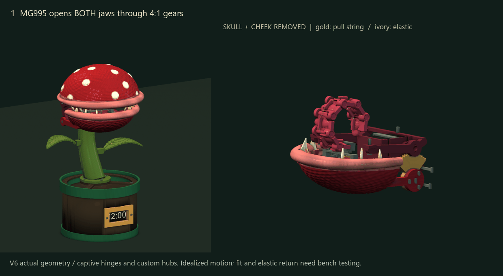
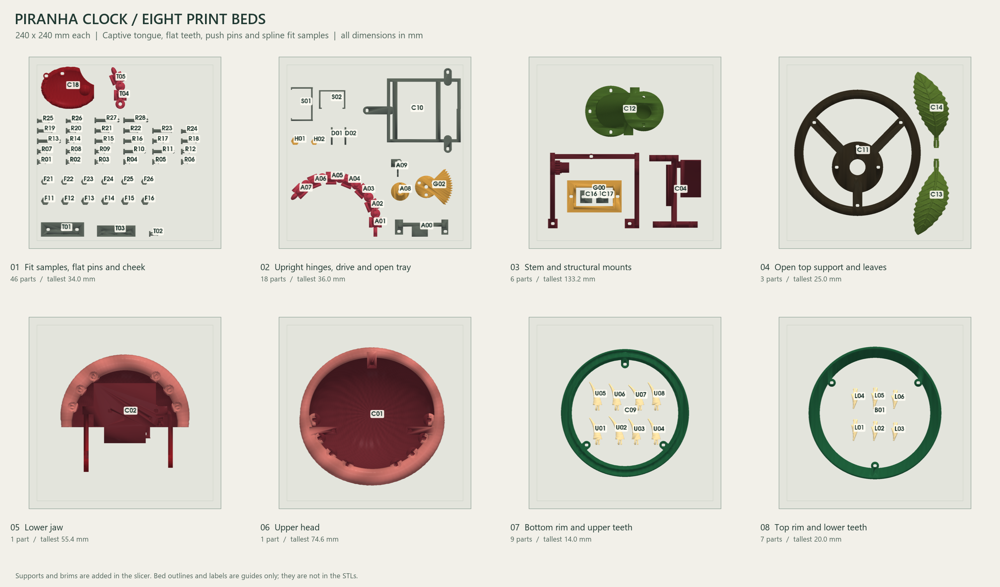

# Piranha Clock V6 — press-fit and filament conscious

An MG995 lifts the upper head 50° and gears the lower jaw down 12.5°. An MG90S in the lower jaw pulls a string to unroll a 154 mm segmented tongue; light elastic links curl it back into the mouth. The plump lips, irregular skin relief, tongue papillae and internal 4:1 quadrant gear are retained.

V6 uses printed push pins and keepers, custom replaceable servo spline inserts, one captive print-in-place tongue, fourteen flat snap-in teeth, and two pot rims around a user-cut cardboard or foamcore sleeve. No assembly screws, nuts, metal hinge pins, glue or cable ties are specified. String and elastic still need threading and tying.

**Print-fit update:** the connector pins now print flat with the tested three-dot clearance. The tongue keeps vertical hinge axes, wider tab clearance and a partly curled print pose. See [what changed and what to reprint](docs/PRINT_FIT_UPDATE.md).



## Start here

- [Rhino print beds](cad/Piranha_Clock_V6_Print_Beds.3dm): eight 240 × 240 mm BED layers, one group per bed.
- [Assembled Rhino model](cad/Piranha_Clock_V6_Press_Fit.3dm): extended, curled and exposed-mechanism poses. Both documents are Rhino 7 compatible closed **mesh solids**, in millimetres.
- [Eight bed STLs](print_beds/) and [print guide](docs/PRINT_BEDS.md). The tallest part is 133.2 mm; check your printer's Z travel.
- [Assembly and string routing](docs/ASSEMBLY.md), [custom hub fitting](docs/CUSTOM_HUBS.md), [flat teeth](docs/TEETH.md), [sleeve cut templates](docs/SLEEVE.md).
- [Materials and electronics](docs/BOM.md), [UNO R4 Minima wiring/calibration](docs/ELECTRONICS.md), [validation limits](docs/VALIDATION.md).

**Print the fit pieces first.** Your measured shaft diameters/heights are incorporated, but spline tooth counts and flank shape remain unconfirmed. The supplied hub profiles are trial fits. Do not force a sample onto a metal shaft or assume a smooth bore establishes a torque-capable connection.

The complete part set uses approximately **25.5% less CAD solid volume** than V5, including the fit samples. This is not a slicer filament estimate; supports, infill, walls and purge change actual usage. The two rings are the printed pot enclosure; the open internal tray and stem support remain structural parts.



The saved meshes, print-bed bounds and sampled rigid motion are digitally checked. The user printed the earlier tongue and confirmed the three-dot pin-hole fit. This updated geometry has not yet been physically printed or load-tested. Hinge release, spline grip, snap durability, sleeve stiffness and elastic return require a prototype build. Use one complete revision; V6 parts are not a drop-in conversion of every V5 joint. This project contains only the current V6 design.

## Rebuild

Install Python 3.12 and `source/requirements.txt`, then run from this directory:

```text
python source/build_segmented.py
python source/validate_motion.py
python source/validate_cords.py
python source/validate_print_features.py
python source/validate_fit_update.py
python source/layout_print_beds.py
python source/sector_report.py
python source/render_segmented.py
python source/render_segmented.py --gif
python source/make_guides.py
```

The default build generates the base and all V6 parts from source, without requiring earlier versions. Previews use Windows Segoe UI. Parameter changes require rebuilding, rechecking and regenerating the beds. Keep the PIP assemblies in their shared print coordinates.

Unofficial fan-made physical prototype inspired by Nintendo's Piranha Plant. This project is not affiliated with Nintendo. No license to Nintendo characters or branding is implied.
