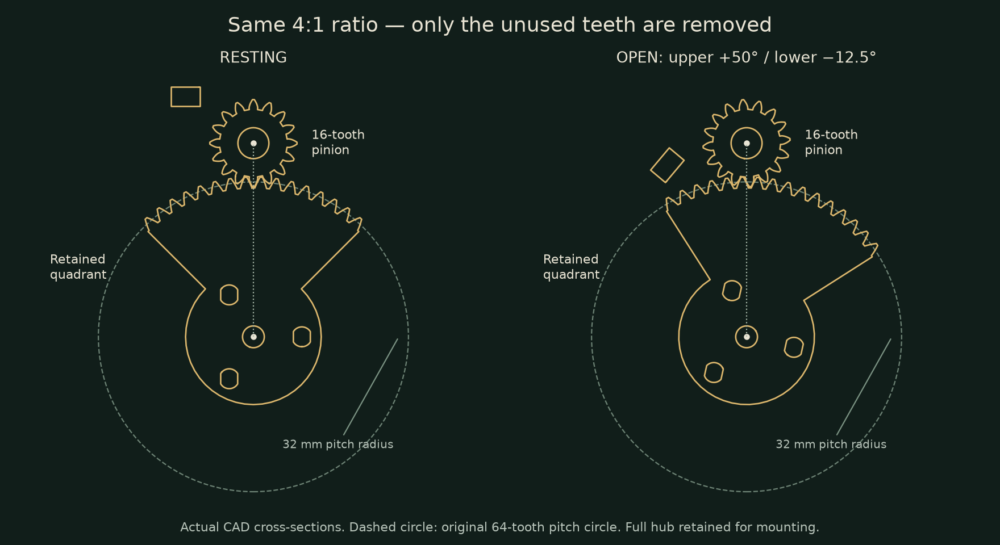

# Mechanism

MG995 directly rotates G00, which incorporates the upper carrier and a 16-tooth pinion. G02 retains the working quadrant of a 64-tooth gear, so its 32 mm pitch radius remains four times the pinion's 8 mm radius. Both gears use module 1, a 25° pressure angle, nominal 0.20 mm pair backlash and 40 mm center spacing. The pinion turns 50° and the lower jaw turns 12.5° in the opposite direction. Removing unused sector teeth does not change the ratio. The full sector hub remains for its pivot and three push-pin connections.

The gears sit inside the head behind fixed removable cheek C18. The two servo cases may remain visible inside the mouth. C18 also retains the upper rotor axially. The MG90S moves with the lower jaw and winds an underside string onto A08. A09 guides that string and retains the drum axially. Neither output uses a stock horn or center screw.

The tongue has seven sections on a 22 mm pitch and six captive hinges. Each hinge permits 0–45° upward curl. An underside tendon straightens the chain, while six light elastic links across its upper side restore the curl. The nominal tendon difference from curled to straight is 22.986 mm; a 10 mm effective drum radius requires 131.700°. Gravity helps extension but must be overcome during return. Joint friction and unequal elastic tension are not represented by the equal-angle model.

The controller opens the jaws, deploys the tongue, chirps, releases the tendon, then closes the jaws. It has no position or force feedback. Full return is a physical tuning requirement before automatic operation. The GIF is a kinematic illustration made from the actual meshes, not a gravity/elastic/contact simulation or proof of reliable operation.

